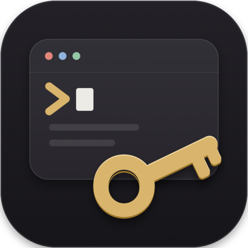
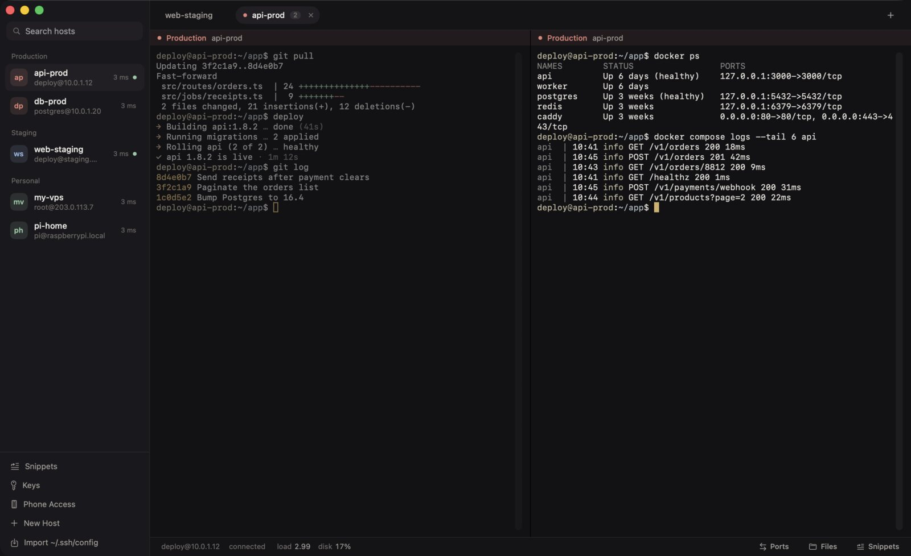
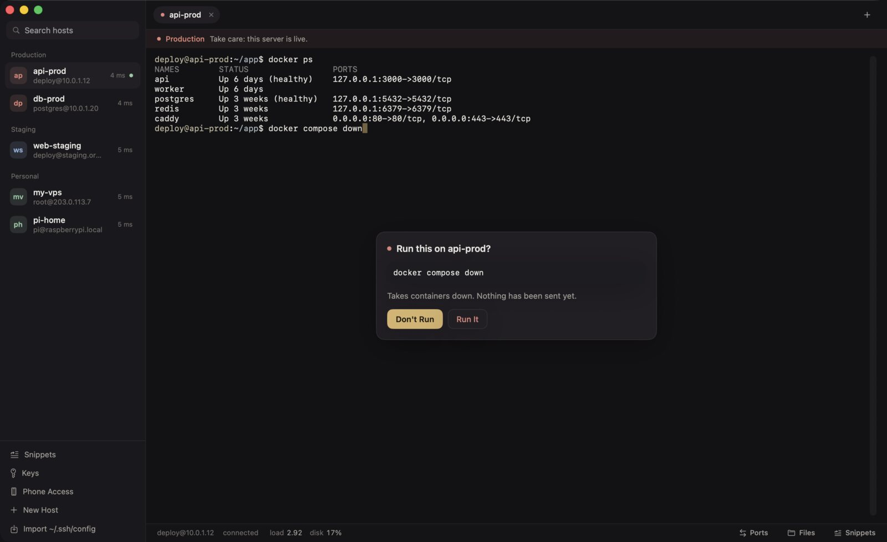
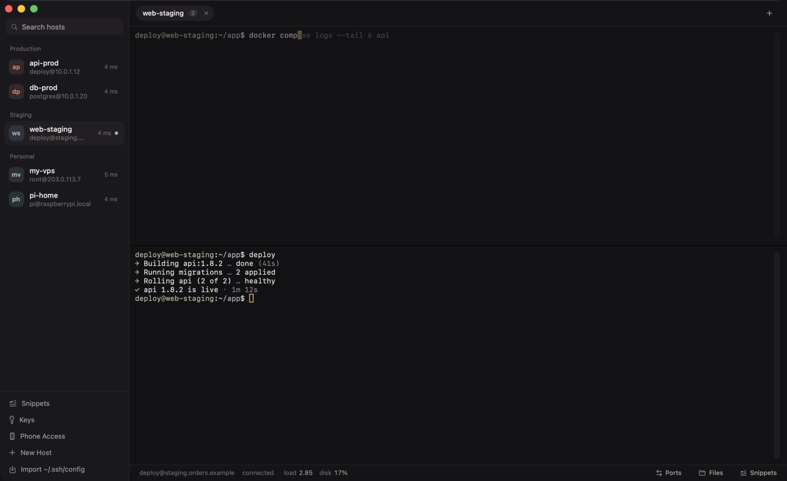
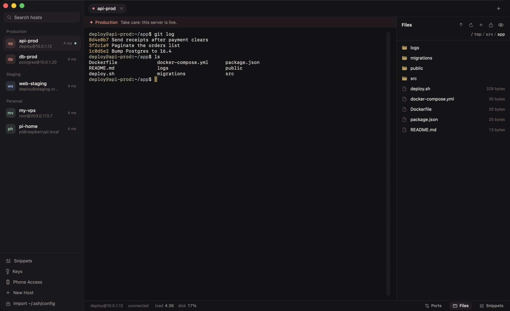
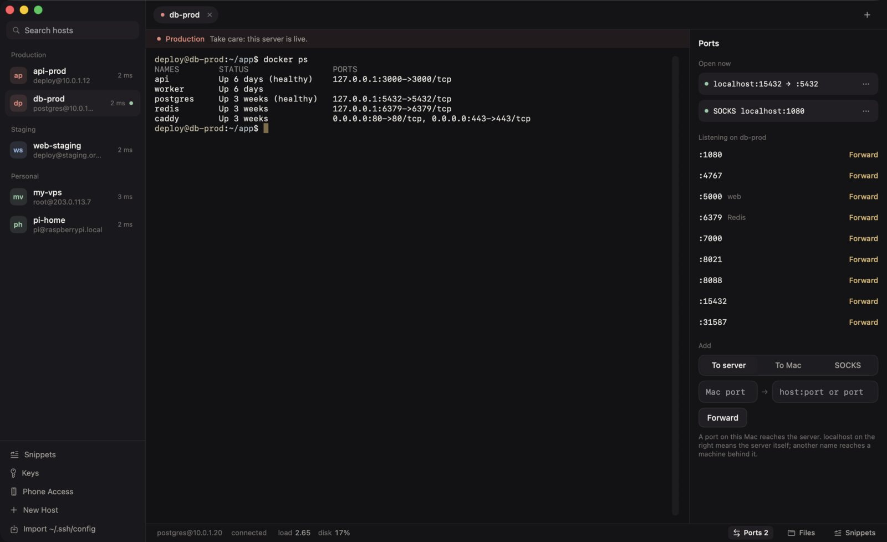
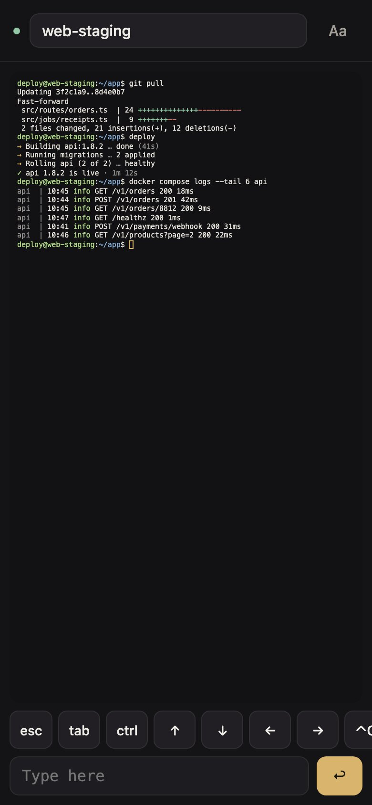

<p align="center">
  
</p>

<h1 align="center">Clavra</h1>

<p align="center">
  <b>Every server, one key.</b><br>
  An SSH client for the Mac that knows which servers are production,<br>
  and asks before a command you can't take back.
</p>

<p align="center">
  
  
  
  
</p>

<p align="center">
  <a href="https://github.com/Naqara-Dev/clavra/releases/latest"><b>Download for Mac</b></a> ·
  <a href="https://clavra.naqara.dev">clavra.naqara.dev</a>
</p>

<p align="center">
  
</p>

## Why Clavra?

Most SSH clients treat every server the same. Clavra knows the one that pays your salary.

- **A yes before `rm -rf`.** On a production host, Return on a risky command (`rm -rf`, `DROP TABLE`, a `DELETE` without `WHERE`, `shutdown`, `docker compose down`, a force push and more) holds it back until you confirm. Pastes, snippets and every split pane are checked too.
- **Calm where it can be.** Hosts sit by place: personal, staging, production. Production gets a coral mark on every pane; everything else stays out of your way.
- **Everything one click away.** Files, tunnels, server health and your saved commands live beside the terminal, not in three other apps.
- **Local first.** No account and no telemetry. Hosts are a file on your Mac, passwords and passphrases live in your Keychain, keys stay in `~/.ssh`.

## Features

| | |
|---|---|
| **Production guard** | Holds back commands that are hard to take back, on production hosts or any host you turn it on for. Nothing reaches the server until you say so. |
| **Split panes** | ⌘D beside, ⇧⌘D below, ⌥⌘ arrows to move, dividers you can drag, the way you know from iTerm. Type into every pane in a tab at once with ⌥⌘I. |
| **Suggestions** | Commands you ran on that host appear in grey after the cursor; → takes them. Anything that looks like it holds a password is never kept, and production keeps nothing on disk. |
| **Files** | SFTP beside the terminal: whole folders both ways, drag and drop, permissions, and editing in any Mac app with each save going back up. Uploads land under a temporary name first, so a dropped connection never leaves half a file. |
| **Tunnels** | Local, remote and SOCKS (`ssh -L`, `-R`, `-D`). The ports the server listens on are offered one click away; tunnels saved with a host open on every connect. |
| **Server health** | How fast each host answers, in the sidebar. While connected: load, memory, disk and uptime, turning coral when something runs hot. |
| **Phone Access** | Scan a QR code and your tabs open in the phone's browser, end-to-end encrypted. Production tabs are view only from a phone unless you allow typing. |
| **Sign-in** | Ed25519, RSA and ECDSA keys (passphrases supported) or passwords, jump hosts, and host keys checked against `~/.ssh/known_hosts`. Save a user and key once as an identity and share it across hosts. Import `~/.ssh/config` in one click. |
| **Hosts** | Home lists every host by place with Connect, Test Connection and Edit on each. Tags, and a sidebar you can group by place or tag and fold shut. |
| **Keys** | Every key in `~/.ssh` with its type, age and the hosts that use it. Weak or world-readable keys are called out; a new Ed25519 key is one click. |
| **And** | Find in scrollback, snippets (⌘;), reconnecting on its own, `ssh://` links, a menu bar host list, tabs restored on launch, iCloud Drive sync and in-place updates. |

<p align="center">
  
  
  
  
</p>

## Install

1. Download **Clavra-X.dmg** from the [latest release](https://github.com/Naqara-Dev/clavra/releases/latest) and drag Clavra to Applications.
2. Open it once. When macOS blocks it, open **System Settings › Privacy & Security** and click **Open Anyway**. (Clavra isn't notarized by Apple yet.) Or, in Terminal:
   ```sh
   xattr -dr com.apple.quarantine /Applications/Clavra.app
   ```
3. Click **Import ~/.ssh/config**, or type `user@server` in **Where to?**, and mark the hosts that matter as **Production**.

Step 2 is once only: updates install in place from **Clavra › Check for Updates…**, checked against Naqara Dev's signing key. Requires macOS 15 or later, Apple Silicon or Intel.

## Your tabs, on your phone



Turn on **Phone Access**, point the phone's camera at the QR code, and allow the phone on the Mac. Your tabs open in the phone's browser with Esc, Tab, Ctrl and the arrows a tap away; scroll back through earlier output, or open a saved host in a new tab from the phone.

- **From anywhere.** Phone and Mac meet through [clavra.naqara.dev](https://clavra.naqara.dev) over HTTPS, or straight over your Wi-Fi if you prefer.
- **The relay can't read it.** Everything is sealed with ChaCha20-Poly1305 under a key that exists only in the QR code. The relay passes along data it can't open.
- **You stay in charge.** Every new phone has to be allowed on the Mac, production tabs are view only unless you say otherwise, and access turns itself off after 30 quiet minutes.

<br clear="right">

## Privacy

Clavra connects to your servers, to GitHub once a day for updates (you can turn this off), and to clavra.naqara.dev only while Phone Access is on through the relay. There are no analytics, no telemetry and no account. The optional reachability check opens and closes a TCP connection to each host's SSH port every five minutes, sends nothing, and can be turned off in Settings.

## Build from source

```sh
xcodebuild -project Clavra.xcodeproj -scheme Clavra -configuration Debug \
  -derivedDataPath build -clonedSourcePackagesDirPath build/SourcePackages build
./scripts/test.sh   # logic and crypto checks
./scripts/e2e.sh    # every feature against a throwaway sshd on this Mac
```

Xcode 26 or later. Releases, the test harness, debug launch arguments, dependencies and the clavra.naqara.dev site are in [docs/DEVELOPMENT.md](docs/DEVELOPMENT.md).

## Contributing

Bug reports and ideas are welcome in [Issues](https://github.com/Naqara-Dev/clavra/issues). Clavra is made by [Naqara Dev.](https://naqara.dev), a small studio in Indonesia.
